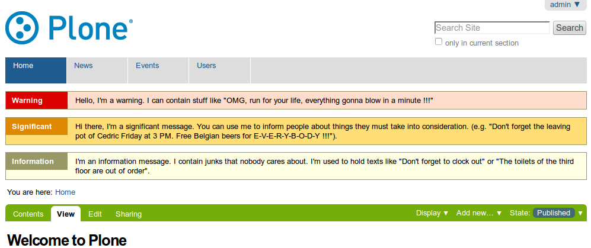
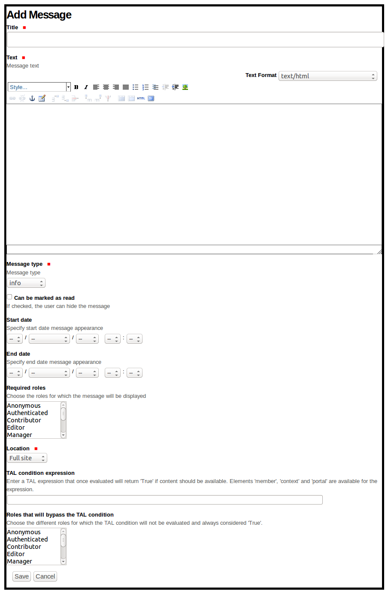

.. image:: https://github.com/collective/collective.messagesviewlet/actions/workflows/test-matrix.yml/badge.svg?branch=master
    :target: https://github.com/collective/collective.messagesviewlet/actions/workflows/test-matrix.yml

.. image:: https://coveralls.io/repos/collective/collective.messagesviewlet/badge.svg?branch=master
  :target: https://coveralls.io/github/collective/collective.messagesviewlet?branch=master

.. image:: http://img.shields.io/pypi/v/collective.messagesviewlet.svg
   :alt: PyPI badge
   :target: https://pypi.org/project/collective.messagesviewlet

.. This README is meant for consumption by humans and pypi. Pypi can render rst files so please do not use Sphinx features.
   If you want to learn more about writing documentation, please check out: http://docs.plone.org/about/documentation_styleguide_addons.html
   This text does not appear on pypi or github. It is a comment.

==============================================================================
collective.messagesviewlet
==============================================================================

Add-on displaying manager defined messages in a viewlet

Features
--------

Messages are defined in control panel.

Multiple messages can be displayed together in the viewlet.

A message contains the following configuration attributes:

* text : displayed text in the viewlet
* message type : info, significant, warning (different layout in the viewlet)
* can hide : if checked, the user can hide the message (mark as read)
* start date : displaying start date (optional)
* end date : displaying end date (optional)
* required roles : user must have one of the required roles (optional)
* use local roles : message displayed for users having Reader local role on message (optional)
* location : full site or homepage only

Local messages can also be authorized (through control panel) to be added in any
folderish content types and you can then choose if / on which levels they display.

The collective.behavior.talcondition is enabled, providing 2 attributes.

* tal condition : optional tal expression evaluated on viewlet context
* bypassing roles : optional roles bypassing the tal condition

A workflow is provided with the following states:

* inactive : not displayed
* activated : displayed

The hiding functionality uses a cookie. It is necessary to (re-)activate a message to "reset" the cookie.
After new activation, the message will be displayed again even for users that hide it.

The optional 'messages' profile adds some useful examples that can be activated when needed:

* message for scheduled maintenance (limited to Member)
* message for imminent or current maintenance : (given to anonymous)
* message for staging site

There is also a PseudoMessage class that can be instantiated and used in viewlet templates.

Limitations
-----------

This add-on supports Plone 6.1 and 6.2 on Python 3.10 to 3.13, and is tested on
each of them. Use version 1.0b5 for Plone 4.3 to 6.0.

Improvements
------------

* Modify hidden_uid when some fields are changed: end when gone, can_hide (to unchecked), start when end is gone
* Message definition from file system
* Message definition from rss feed

Translations
------------

This product has been translated into

- English
- French

Installation
------------

Add ``collective.messagesviewlet`` to the dependencies of your project (``pip``,
``uv`` or buildout ``eggs``), restart Plone, then install the add-on in the
Add-ons control panel.

Development
-----------

You only need `uv <https://docs.astral.sh/uv/>`_ ::

    make install         # .venv (Python 3.12, Plone 6.2.3) and instance configuration
    make create-site     # create a "Plone" site with collective.messagesviewlet installed
    make start           # http://localhost:8080/Plone (admin / admin)
    make console         # debug console on the instance
    make i18n            # update the translation files
    make remove-data     # remove all content (and the .venv)

``make clean && PLONE_VERSION=6.1-latest make install`` builds against another Plone release, and
``DELETE_EXISTING=1 make create-site`` recreates the site.

Tests and code quality are managed by `plone.meta <https://github.com/plone/meta>`_ and
`tox <https://tox.wiki>`_ ::

    make test            # tests with Plone 6.2.3
    make lint            # pre-commit hooks (black, isort, flake8, zpretty, codespell...)
    make format          # reformat code
    make test-all        # lint, every supported Python / Plone version, dependency checks

Any tox environment can be run directly, e.g. ``uvx --with tox-uv tox -e py313-plone61``.
Do not edit the files generated by plone.meta: change ``.meta.toml`` and run
``uvx --from plone.meta config-package --branch current .`` instead.

Contribute
----------

- Issue Tracker: https://github.com/collective/collective.messagesviewlet/issues
- Source Code: https://github.com/collective/collective.messagesviewlet

Support
-------

If you are having issues, please let us know.

License
-------

The project is licensed under the GPLv2.
